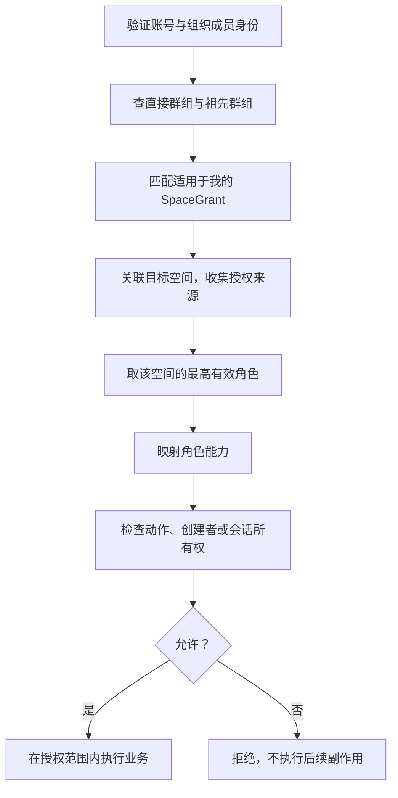

# 空间权限系统学习笔记：从关系到一次授权决定

学习日期：2026-09-07 至 2026-09-08。本文按本次讨论顺序整理，供回顾首版实现。

本文解释“为什么这样设计、代码怎样计算”，不是生产部署验收报告。完整方案见 [权限系统设计](superpowers/specs/2026-09-04-tenant-group-space-permission-design.md)，实施状态见 [实现与验收](space-permissions-implementation.md)。

## 1. 先记住整体链路



ReBAC 的核心是根据关系决定访问资格；RBAC 的核心是角色到能力的映射。我们选择让关系先匹配空间角色，再判断动作；ReBAC 本身并不要求必须通过角色，也可以直接表达“本人拥有的会话可读”等关系条件。

## 2. 六种对象，各自记录什么

| 对象 | 回答的问题 | 例子 |
|---|---|---|
| User | 你是谁？ | 小林的全局账号 |
| Tenant | 数据属于哪个组织？ | A 公司，也可以是学校或协会 |
| TenantMembership | 你在这个组织是什么身份？ | 小林在 A 公司的成员身份 |
| Group / GroupMembership | 组织有哪些群组，你加入了哪些？ | 小林在 A 公司加入研发部和项目组 |
| Space | 资源放在哪里？ | A 公司的技术空间 |
| SpaceGrant | 谁在这个空间拥有什么角色？ | 研发部在技术空间是 EDITOR |

### 2.1 User 是人，TenantMembership 是组织内的工牌

```text
User：小林
├── TenantMembership A：小林在 A 公司的身份
└── TenantMembership B：小林在 B 组织的身份
```

加入群组和个人授权指向 TenantMembership，不直接指向全局 User。停用 A 公司的成员身份，不会因此删除全局账号或停用 B 组织身份。

GroupMembership 是“这个组织内身份加入这个群组”的关系，本身不授予 EDITOR。还需要 SpaceGrant 才能连接到资源权限：

```text
小林 → A 公司成员身份 → 加入研发部 → 研发部被授予技术空间 EDITOR
```

### 2.2 tenant_id 不表示授权给全公司

每条 Grant 都有 tenant_id，首先用于限定组织归属。授权给谁由 subject_type 决定：

| tenant_id | subject_type | 主体字段 | 含义 |
|---|---|---|---|
| A 公司 | TENANT | 无额外主体字段 | 给 A 公司全体有效成员 |
| A 公司 | GROUP | group_id=研发部 | 给研发部及其后代群组的有效成员 |
| A 公司 | MEMBER | tenant_membership_id=小林的 A 公司身份 | 直接给小林的组织内身份 |

同一 Grant 的三种主体互斥。Space 记录空间信息；SpaceGrant 记录授权；ROLE_CAPABILITIES 在代码里定义角色能力。不能把这三者混为一谈。

### 2.3 公共、部门、私有是授权预设

公共空间给 Tenant 全体授权；部门空间给 Group 授权；个人空间给本人 TenantMembership 授权。它们都是 Space，不是三套资源模型。空间也可以同时分享给多个群组和成员。

ACL 全称是 **Access Control List，访问控制列表**。一个空间的多条 SpaceGrant 共同构成它的 ACL；有效访问还要结合身份状态和群组关系计算。

## 3. ReBAC：SQL 怎样找到授权

代码入口：[authorization_repo.py](../app/infrastructure/postgres/repositories/authorization_repo.py)，重点看 ACCESS_CTE 与 space_access()。

### 3.1 active_member：有效身份，而不是一张实体表

active_member 是 CTE（公用表表达式），仅在当前 SQL 中作为命名结果集使用。

```sql
WITH RECURSIVE active_member AS (
    SELECT m.id
    FROM tenant_memberships m
    JOIN tenants t ON t.id = m.tenant_id AND t.status = 'active'
    JOIN users u ON u.id = m.user_id AND u.is_active
    WHERE m.tenant_id = :tenant_id
      AND m.id = :membership_id
      AND m.user_id = :user_id
      AND m.status = 'active'
)
```

它同时检查账号、组织、组织成员身份有效，并验证三个 ID 的对应关系。正常情况下返回零行或一行，不是查询全公司的成员。SELECT m.id 返回的是 TenantMembership ID。

后面的 EXISTS (SELECT 1 FROM active_member) 只判断有没有记录，数字 1 不是成员 ID。

### 3.2 为什么有 GroupMembership，还要筛选成员 ID？

GroupMembership 存的是所有人的群组关系：

| tenant_membership_id | group_id |
|---|---|
| 小林 | 后端组 |
| 小林 | 项目组 |
| 小王 | 财务组 |

筛选 gm.tenant_membership_id 是为了只取“我的关系”；JOIN groups 是为了取得群组的父节点和活动状态。这两个步骤缺一不可。

```sql
SELECT g.id, g.parent_group_id
FROM group_memberships gm
JOIN groups g
  ON g.id = gm.group_id AND g.tenant_id = gm.tenant_id
WHERE gm.tenant_id = :tenant_id
  AND gm.tenant_membership_id IN (SELECT id FROM active_member)
  AND g.status = 'active'
```

此处 INNER JOIN 写成 groups JOIN group_memberships 或反过来，含义相同；书写顺序不等于数据库实际执行顺序。

### 3.3 递归：向上查祖先

实际 CTE 的结构如下，需与前面的 active_member 放在同一条 WITH RECURSIVE 查询中：

```sql
member_groups AS (
    SELECT g.id, g.parent_group_id
    FROM groups g
    JOIN group_memberships gm
      ON gm.tenant_id = g.tenant_id AND gm.group_id = g.id
    WHERE gm.tenant_id = :tenant_id
      AND gm.tenant_membership_id IN (SELECT id FROM active_member)
      AND g.status = 'active'

    UNION

    SELECT p.id, p.parent_group_id
    FROM groups p
    JOIN member_groups c ON p.id = c.parent_group_id
    WHERE p.tenant_id = :tenant_id AND p.status = 'active'
)
```

p 每轮引用 groups 表；递归项中的 c 可理解为上一轮新增的工作结果。p.id = c.parent_group_id 决定查询方向是向上找父组。数据库负责迭代，无需应用程序循环调用 SQL。

例子：G3 后端组 → G2 平台组 → G1 研发部 → 无父组。用户直接加入 G3 和 G2：

| 阶段 | 本轮 c | 找到的父组 | UNION 去掉累计重复后 |
|---|---|---|---|
| 初始查询 | — | — | G3、G2 |
| 第一轮递归 | G3、G2 | G2、G1 | G1 |
| 第二轮递归 | G1 | 无 | 空，结束 |

最终集合为 G3、G2、G1。UNION 对查询输出的整行去重；此处输出 id 与 parent_group_id，在合法树结构下共同实现祖先去重。业务仍禁止群组形成环路，不能用 SQL 去重替代树结构校验。

**查询向上找祖先，授权效果是父组覆盖后代成员。** 只直接加入研发部，不会获得仅授予后端组的权限。

ER 图中 Group 的自关联表示父子关系：每个群组零或一个父组、零或多个子组，不表示允许循环归属。

### 3.4 matched_grants：匹配三条授权路径

```sql
matched_grants AS (
    SELECT sg.* FROM space_grants sg
    WHERE sg.tenant_id = :tenant_id
      AND sg.revoked_at IS NULL
      AND EXISTS (SELECT 1 FROM active_member)
      AND (
          sg.subject_type = 'TENANT'
          OR (sg.subject_type = 'MEMBER'
              AND sg.tenant_membership_id = :membership_id)
          OR (sg.subject_type = 'GROUP'
              AND sg.group_id IN (SELECT id FROM member_groups))
      )
)
```

三个 OR 分别匹配组织全体授权、本人直接授权、群组及祖先授权。得到的是当前租户中适用于我的授权，不是整个系统的授权，也还没有合并最高角色。

## 4. 按空间归集，再计算角色

space_access() 将 matched_grants 关联到 Space：

```sql
FROM spaces s
JOIN matched_grants g
  ON g.space_id = s.id AND g.tenant_id = s.tenant_id
```

再按组织、空间状态过滤；指定 space_id 时限定目标空间。没有匹配授权的空间不会出现在 INNER JOIN 结果中。

GROUP BY s.id 与 jsonb_agg(...) AS permission_sources 把结果整理为每个空间一行：

```python
# 简化后的结果形状
{
    "space_id": "技术空间ID",
    "permission_sources": [
        {"subject_type": "TENANT", "role": "VIEWER"},
        {"subject_type": "GROUP", "role": "EDITOR"},
    ],
}
```

visibility_summary 的 CASE WHEN 只用于显示公共、团队或私有分类，不负责授权。

代码入口：[authorization.py](../app/domain/authorization.py)，重点看 decorate_access()：

```python
def decorate_access(row: dict) -> dict:
    sources = row["permission_sources"]
    role = max(
        (s["role"] for s in sources),
        key=lambda r: ROLE_RANK.get(r, 0),
    )
    return {
        **row,
        "effective_role": role,
        "capabilities": sorted(ROLE_CAPABILITIES[role]),
    }
```

ROLE_RANK 定义 VIEWER=1、EDITOR=2、MANAGER=3。max 返回最高角色的名字，不是等级数字；sorted 只固定能力列表顺序。

**最高角色仅在当前用户、当前组织、当前空间范围内计算。** 技术空间 EDITOR 不会提升公共空间权限，更不会变成 TENANT_ADMIN。个人 VIEWER 也不会覆盖群组 EDITOR，因为本版取并集，没有直接授权优先或显式 DENY。

## 5. RBAC 与资源关系条件

| 空间角色 | 能力 |
|---|---|
| VIEWER | 阅读、搜索、问答 |
| EDITOR | 上述能力，加上传、删除或重试本人创建的文件 |
| MANAGER | 上述能力，加空间管理、删除或重试空间内任意文件 |

请求动作 document.delete 表示“想删除这份文件”；能力 document.delete_own 或 document.delete_any 表示允许删除的范围。

```python
def permits(role: str, action: str, membership_id: str, owner: str | None = None) -> bool:
    capabilities = ROLE_CAPABILITIES.get(role, frozenset())
    if action in ("document.delete", "document.retry"):
        return action + "_any" in capabilities or (
            action + "_own" in capabilities
            and bool(owner)
            and str(owner) == membership_id
        )
    return action in capabilities
```

frozenset 是不可修改的集合。未知角色默认得到空能力集合。owner 在文档检查里传入 created_by_membership_id，比较的是组织成员身份，不是可由请求方自称的创建者。

VIEWER 即使是文件创建者，也没有删除能力；创建者关系不能单独赋权。文件创建者、会话所有者属于关系条件，因此不要把 ReBAC 理解成只能用来推导角色。

permits() 只计算真假；它不验证账号、查询数据库或执行删除，必须由调用链提供已校验的上下文与资源事实。

## 6. 删除请求如何用上这套设计

| 代码入口 | 阅读重点 |
|---|---|
| [document Router](../app/api/routers/document.py) | delete_document() 从 require_user 获得可信上下文 |
| [DocumentService](../app/services/document_service.py) | delete() 一开始检查 document.delete |
| [AuthorizationService](../app/services/authorization_service.py) | authorize_document() 查所属空间和创建者，再调用 authorize_user() |

```text
DELETE 文件ID
→ 认证及组织成员身份校验
→ authorize_document()
→ 从数据库取得文件的空间和创建者
→ authorize_user() 查询关系、合并角色、调用 permits()
→ 通过后才修改状态、删除文件与索引、清理缓存
```

前端隐藏按钮不能阻止用户直接发 HTTP 请求，因此后端必须检查。检查放在可复用 Service 的入口，而不仅放在 Router，覆盖其他业务流程的调用。

授权检查通过并不意味着跨存储删除具有单一数据库事务；存储失败恢复是另一项业务生命周期问题，不应与授权事务混淆。

## 7. 列表：权限过滤在分页之前

先查询租户 20 份文件，再删去无权记录，会产生缺页、空页、错误总数，并可能泄露不可见资源数量。

本版要求文件列表明确指定一个空间：先授权空间可读，再用相同组织、空间与文档状态条件查询数据和总数，最后分页。

读取范围与操作能力分开：EDITOR 可以看空间内所有文件，但每条文件的删除、重试能力需要结合创建者计算。

## 8. 搜索：两个产品约束简化了授权

本版明确规定：

1. 一次普通搜索或聊天指定一个 Space，后端必须验证这个范围。
2. 文件统一继承空间权限，没有文件级例外 ACL。

因此可以先验证空间可读，再按 tenant_id + space_id 检索。未来全空间搜索需要先计算可读空间集合；若增加文件级例外，还要细化到文件范围。

### 8.1 入口先授权

[RetrievalService.search()](../app/services/retrieval_service.py)：

```python
await authorization.authorize_user(req.tenant_id, req.user_id, req.space_id, "space.read")
# 通过后，才将同一 tenant_id、space_id 传给 _orchestrator.retrieve()
```

### 8.2 检索引擎过滤

[Milvus](../app/infrastructure/milvus/client.py) 的 _build_search_filter() 生成组织 AND 空间条件；[Elasticsearch](../app/infrastructure/elasticsearch/client.py) 的 _build_search_filters() 把两者放进 bool.filter。附加的文档与元数据过滤进一步缩小范围。

### 8.3 切片回表再约束归属

[ChunkRepository.get_chunks_by_ids()](../app/infrastructure/postgres/repositories/chunk_repo.py) 的核心 SQL：

```sql
FROM document_chunks dc
JOIN documents d ON dc.document_id = d.id AND dc.tenant_id = d.tenant_id
WHERE dc.chunk_id = ANY(:chunk_ids)
  AND dc.tenant_id = :tenant_id
  AND d.space_id = :space_id
  AND d.deleted_at IS NULL
  AND d.status NOT IN ('deleting', 'deleted')
```

授权判断“这个人能否读”，过滤条件保证“读到的确实属于这个范围”。不能先向模型提供全公司内容，再要求它不要泄露。

## 9. 派生内容与撤权

```text
Space → Document → Chunk → 检索上下文 → 回答
                                      ├── 引用快照
                                      ├── 内容缓存
                                      └── 来源空间内的个人记忆
```

| 内容 | 访问规则 |
|---|---|
| 文件、切片、普通检索结果 | 当前可读所属空间 |
| Session、Message、历史 Citation | 会话本人，且当前仍可读原空间 |
| 自动提取的 Memory | 同组织、同用户、同空间，并经当前访问检查 |
| 空间回答缓存 | 先授权，再读取对应组织和空间的缓存 |

共享文件不代表共享每个人的聊天。聊天上传形成的 Document 按所属空间授权，可能被其他有权成员读取；消息本身仍受会话所有权限制。

Citation 保存快照用于历史追溯，保留快照不等于撤权后仍可读。数据保留和访问允许是两个独立问题。

本版不缓存授权决定，后续请求重查当前关系；内容缓存可以保留，但无权请求不能读取。已开始的 SSE 以开始时授权为准，不承诺撤权瞬间中断已有流或收回已传出的内容。

## 10. 并发、事务与治理

### 10.1 两个管理者同时撤销自己

若双方都先读到“还有另一位管理者”，再分别撤销，可能导致最终无人管理。单纯做一次检查不够。

当前管理变更先锁 Tenant；空间治理还锁 Space。相关变更按统一顺序串行检查。Grant 修改、最后管理者检查和审计写入位于同一事务：失败整体回滚。

锁协调并发；事务保证一组变更全部成功或全部撤销。锁 Tenant 的方案简单，但同组织管理变更会排队，这是本版的权衡。

### 10.2 组织管理员不自动拥有全部内容

TenantMembership.role 控制组织治理；SpaceGrant.role 控制空间内容。管理员接管需要显式 MANAGER Grant 与原因审计，在同一事务提交。即使接管空间，仍不能读取别人的私人会话。

直接修改授权时保护最后管理者；不能为了保留管理者而阻止离职成员失权。成员停用造成无人管理的空间，由管理员显式接管处理。

## 11. 怎样证明权限确实生效

以删除为例，至少覆盖：

| 场景 | 预期 |
|---|---|
| VIEWER 删除本人文件 | 拒绝 |
| EDITOR 删除本人文件 | 允许 |
| EDITOR 删除他人文件 | 拒绝 |
| MANAGER 删除同空间他人文件 | 允许 |
| 成员停用，携带旧 Token | 拒绝 |

不能只断言返回 403；还应断言拒绝后没有修改状态、删除对象存储或启动后续工作。搜索拒绝后也不能调用检索、缓存或模型。

参考 [角色规则测试](../tests/unit/services/test_authorization_service.py)、[资源边界测试](../tests/unit/services/test_resource_authorization.py)、[真实 PostgreSQL 授权测试](../tests/integration/test_authorization_postgres.py)。测试角色算法、业务拒绝与真实数据库约束，是不同层面的证据。

## 12. 本次容易混淆的点

| 容易误解 | 正确理解 |
|---|---|
| 加入组织或群组就自动能看资源 | 必须存在适用的空间授权 |
| tenant_id 表示授权给全员 | 它首先约束归属，subject_type=TENANT 才表示全员 |
| 个人 VIEWER 覆盖群组 EDITOR | 当前有效授权取最高角色，无覆盖优先级 |
| 移出群组就失去全部访问权 | 只失去经该路径取得的权限，其他路径可能保留 |
| 子空间 EDITOR 能编辑 Tenant | 角色按目标空间计算，租户管理另查 TENANT_ADMIN |
| 创建者永远能删除文件 | 还必须拥有 delete_own 或 delete_any 能力 |
| SQL 递归每轮重用全部累计结果 | 递归工作集是上一轮新增结果，UNION 去重 |
| 保存引用快照就允许永久查看 | 读取仍检查当前空间权限与会话所有权 |
| 只要加 authorize_user() 就够了 | 查询范围、分页、派生内容、事务和测试也要一致 |

## 13. 回顾练习

小林通过研发部获得技术空间 EDITOR，同时直接获得该空间 VIEWER。后来被移出研发部，但组织成员身份仍有效。

先自行判断：能看技术空间吗？能删除自己以前上传的文件吗？能打开自己在该空间的聊天吗？

<details>
<summary>展开答案</summary>

可以读取；不能删除；可以打开自己的聊天。群组 EDITOR 失效，直接 VIEWER 仍然有效。聊天同时满足本人所有权与当前空间可读条件。

若个人 VIEWER 也撤销，且没有其他有效路径，才会全部不可访问。若整个 TenantMembership 停用，则该组织身份的全部路径失效。

</details>

## 14. 以后接入新功能时怎么用

1. 确定资源所属 Tenant、Space，以及是否有本人所有权条件。
2. 根据对象使用 authorize_user、authorize_document、authorize_session；组织管理使用 require_admin。
3. 在内容读取、存储写入、任务提交前检查。
4. 实际查询继续限定组织和授权空间，权限过滤在分页前。
5. 补一个有意义的越权测试，确认拒绝时下游没有执行。

权限缓存、文件级 ACL、跨空间搜索、OpenFGA 可以等需求出现后再深入。当前学习重点是能够解释一次请求为何允许或拒绝，并把同一规则正确接入新业务。
