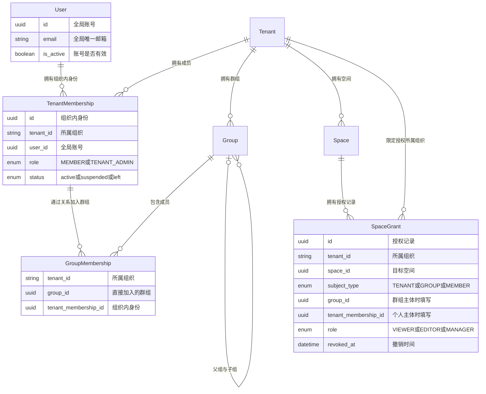
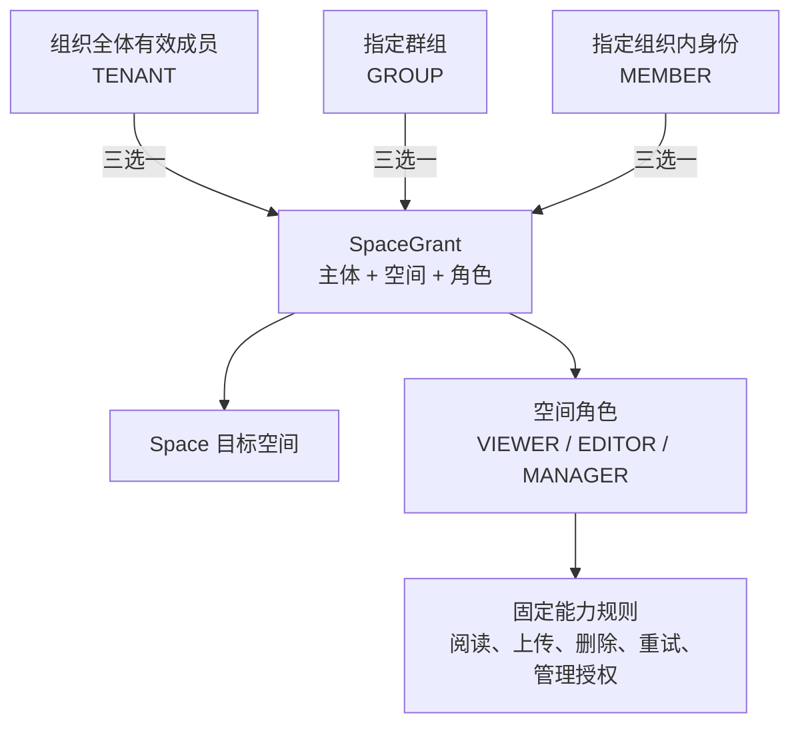
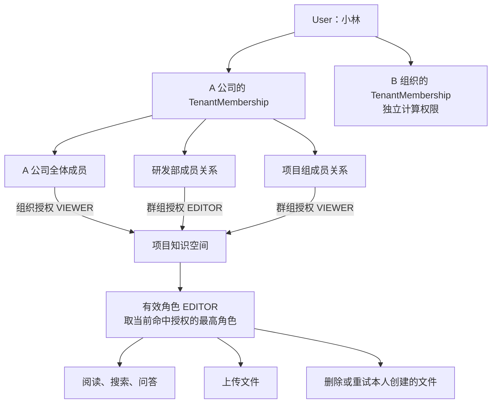
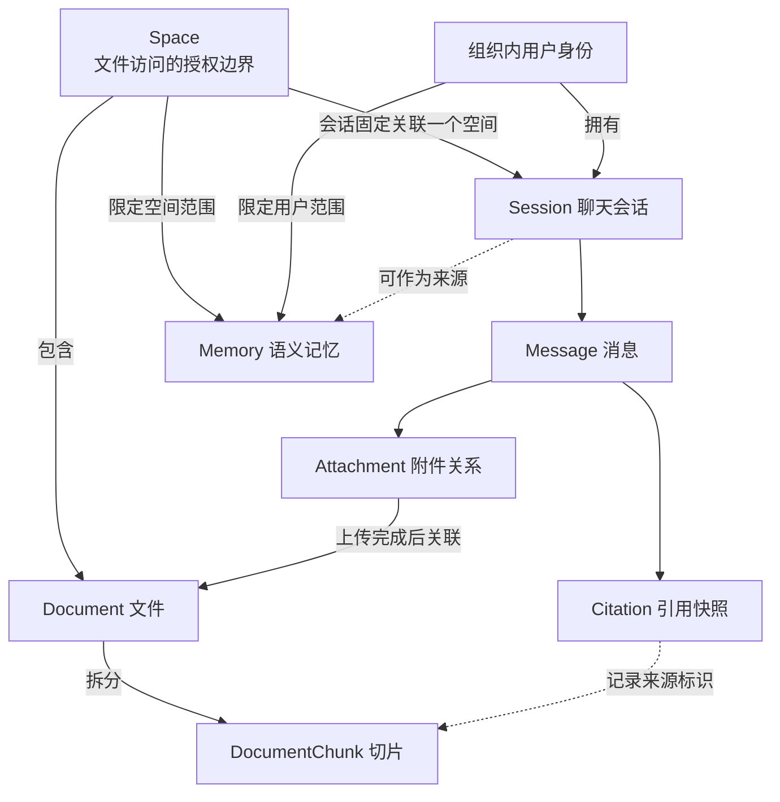
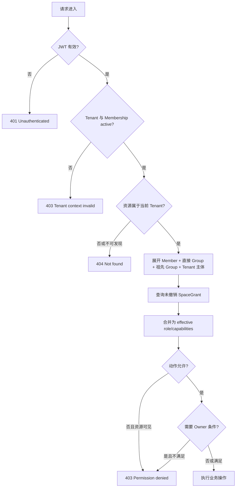
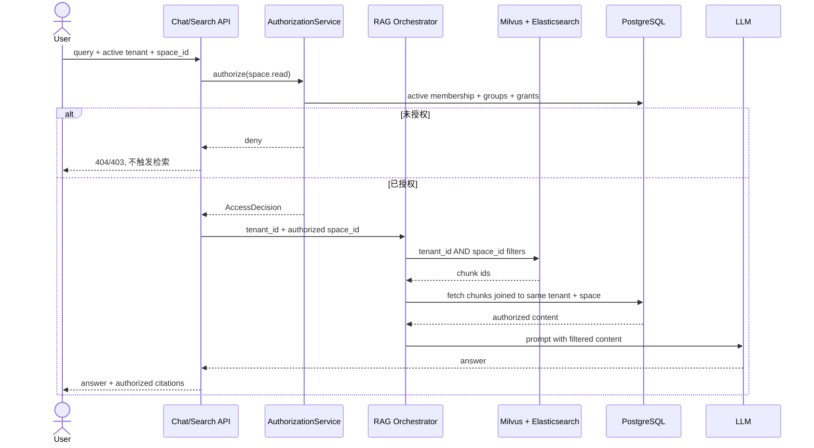
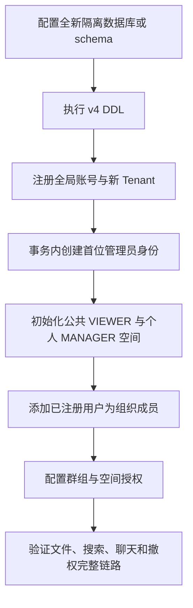

# Tenant、Group 与 Space 权限系统设计

**日期：** 2026-09-04

**状态：** 2026-09-07 更新领域模型与首版实现契约；后端、前端及隔离 PostgreSQL 测试通过，完整运行时端到端验收待完成

**实施修订：** 用户确认没有有效旧数据，本期不做历史数据迁移或所有权回填。使用全新 PostgreSQL 数据库/schema 初始化 v4；脚本检测到旧身份结构会拒绝执行，不自动清空。新语义记忆使用 `arc_memories_v4` 集合，保留旧存储不动。部署前需执行独立数据库集成测试和完整运行时联调，离线测试通过不能代替这些检查。

**范围：** `arc-knowledge-ai` 后端、`arc-knowledge-web` 前端，以及 PostgreSQL、Milvus、Elasticsearch、Redis/语义缓存中的资源访问边界

## 1. 决策摘要

本方案把 Incipit 从“仅按 `tenant_id` 隔离、租户内空间默认全员可见”的模型，升级为通用的多租户资源授权模型：

```text
身份             User
租户隔离         Tenant
租户成员身份     TenantMembership
组织关系         Group + GroupMembership
资源             Space + Document
资源授权         SpaceGrant
授权计算         轻量 RBAC + ReBAC AuthorizationService
```

核心决策如下：

1. `User` 与 `Tenant` 是独立实体，通过 `TenantMembership` 建立多对多关系；一个用户可以加入多个租户，但每次请求只能处于一个经过验证的活动租户上下文。
2. `Group` 是租户内通用用户集合，可表示部门、项目组或委员会。用户可加入多个 Group；Group 可形成树，父 Group 的授权向所有后代 Group 的成员生效。
3. `Space` 是权限容器，`Document`、Chunk、会话检索、语义缓存、引用和空间来源记忆都继承 Space 的可读边界。第一版不提供文件级 ACL。
4. 公共、部门、私有是创建时的授权预设，不是固定且不可变的空间类型；最终访问范围只由 `SpaceGrant` 决定。
5. `SpaceGrant` 可授权给 Tenant 全体、Group 或单个 TenantMembership，角色为 `VIEWER`、`EDITOR`、`MANAGER`。
6. 多条授权只做并集并取最高有效能力；第一版不支持显式 `DENY`、自定义角色、条件授权和跨租户共享。
7. Tenant 管理员拥有控制面治理权，但不自动拥有私有空间内容读取权；读取内容必须执行显式、填写原因且可审计的接管操作。
8. 所有权限判断统一经过 `AuthorizationService`。Router、Service、Repository、检索引擎和前端各自承担不同职责，但不能各写一套权限规则。

## 2. 实施前基线与问题

### 2.1 已有基础

本方案启动时，系统已经具备：

- PostgreSQL 业务表普遍携带 `tenant_id`；
- Milvus 使用 `tenant_id` Partition Key，并按 `tenant_id + space_id` 检索；
- Elasticsearch 查询按 `tenant_id + space_id` 过滤；
- Redis 语义缓存键包含 `tenant_id + space_id`；
- Space、Document、Session、Message、Citation 已形成稳定关联；
- Session 创建后固定归属于一个 Space；
- Space 使用 `archived` 软删除；
- `/documents` 页面已覆盖列表、上传、状态轮询、切片预览和删除。

这些结构允许在不改动文档与检索核心归属关系的前提下，把授权边界加在 Space 上。

### 2.2 本次实现解决的缺口

以下为实施前的缺口，保留用于解释设计动机；不是当前代码仍缺少这些能力。当前验收证据见第 24.5 节。

- `users.tenant_id` 把用户身份与租户身份绑定在同一行，无法表示一个用户加入多个 Tenant；
- 尚无正式 `tenants`、`tenant_memberships`、`groups`、`group_memberships`、`space_grants` 表；
- `GET /spaces` 按 Tenant 返回全部活动空间；
- 文档列表、上传、状态、切片、删除、重试主要依赖 `tenant_id`，无法区分租户内用户权限；
- `/search` 和部分文档路由只使用 `require_tenant()`，没有用户上下文；
- `/chat` 虽有 `user_id`，但没有在检索前验证用户是否可读目标 Space；
- Citation 快照可能在权限撤销后继续暴露历史内容；
- Session 属于用户，但读取 Session/Message 时尚未叠加当前 Space 访问权；
- 语义记忆当前按 `tenant_id + user_id` 全局检索，没有来源 Space 边界；
- Tenant Admin 与 Space 内容读取权尚未分离；
- 现有 `X-Tenant-Id` 是开发回退和旧登录入口的一部分，不能作为生产权限事实来源。

## 3. 目标

- 同一系统支持公司、学校、协会、项目组织等不同 Tenant 语义，不把底层模型硬编码为公司部门制。
- 用户只能发现、列出、读取和操作自己有权访问的 Space 及其派生内容。
- 文件权限默认且完整地继承 Space 权限。
- 一个用户可以加入多个 Tenant、多个 Group；Group 授权支持组织树继承。
- 文件列表、上传、状态、切片、下载、删除、重试、搜索、聊天检索、附件问答、会话历史和引用使用同一权限事实。
- Tenant 隔离始终先于租户内部授权，避免跨租户 IDOR。
- 管理员接管私有空间是显式、可见、可审计的事件。
- 第一版使用现有 PostgreSQL 实现，未来可将 `AuthorizationService` 的决策层替换为 OpenFGA/SpiceDB，而不重写业务入口。

## 4. 非目标

- 不在第一版引入 OpenFGA、SpiceDB、OPA 或 Cedar 独立服务。
- 不提供 Document/Chunk 独立 ACL；文档始终继承 Space。
- 不提供显式 `DENY` 或复杂的允许/拒绝优先级。
- 不提供用户自定义角色、动态策略表达式、IP/时间/密级等 ABAC 条件。
- 不提供跨 Tenant 共享、外部访客或公开互联网匿名访问。
- 不提供跨 Space 检索；一次普通搜索或聊天仍限定一个明确 Space。
- 不在本方案中改变既有文档删除存储策略、会话归档策略或 Space 软删除 ADR。
- PostgreSQL RLS 作为后续纵深防御，本期仍以应用层强制 `tenant_id` 为主。

## 5. 方案比较

### 5.1 方案 A：继续 Tenant 级共享

只为用户增加 Tenant/Group 数据，不建立 SpaceGrant。优点是实现最少；缺点是 Group 不参与资源授权，公共、部门和私有空间无法真正隔离，不能满足需求。

### 5.2 方案 B：PostgreSQL 上的轻量 RBAC + ReBAC（采用）

PostgreSQL 保存成员、群组和授权关系；集中式 `AuthorizationService` 计算“用户能否对资源执行动作”。

优点：

- 与现有 FastAPI、SQLAlchemy 和存储结构直接衔接；
- 事务、迁移、调试和测试边界清晰；
- 当前规模无需额外基础设施；
- 服务接口可保持 Zanzibar/OpenFGA 风格，为后续替换留边界。

代价：

- 必须自行保证所有业务入口都经过授权服务；
- Group 树展开、权限查询和缓存失效需要严格测试；
- 权限复杂到文件级共享、跨租户协作后，不宜继续无限扩展手写 SQL。

### 5.3 方案 C：立即接入外部关系授权引擎

OpenFGA 或 SpiceDB 负责关系元组和授权判断。模型表达力强，但当前还需同时处理数据库与授权引擎的一致性、部署、监控、迁移和故障降级，超出第一版需要。本方案保留兼容接口，达到以下任一条件时重新评估：

- 出现文件级 ACL；
- 出现跨 Tenant 分享或外部访客；
- 出现多层资源继承和自定义角色；
- 授权关系规模或查询复杂度超过 PostgreSQL 可维护范围；
- 多个后端服务需要共享统一授权事实。

## 6. 领域模型

先区分四个概念：`User` 是全局账号，`TenantMembership` 是组织内身份，`SpaceGrant` 是空间授权事实，`Space` 是内容访问边界。下面按核心关系、授权关系和资源关系分别展示，避免把所有外键挤成一张图。

图中一对多关系允许右侧为零个；每个成员身份恰好连接一个 User 和一个 Tenant。根 Group 没有父组，其余 Group 最多一个父组。关系图描述业务关联，不表示每个实体都是独立 DDD 聚合根，也不表示所有关联都用同一种物理外键保存。

**核心实体与关系**



加入群组和个人授权均指向 `TenantMembership`，而不是直接指向全局 User。因此同一用户在两个组织中的成员状态、群组和授权独立计算。每条 Grant 都携带 `tenant_id` 以约束归属，但只有 `subject_type=TENANT` 才表示向该组织全体有效成员授权。

### 6.1 User

`User` 只代表全局登录身份，不再表达“属于哪个组织”。

首版字段（以下实体字段表以当前 v4 DDL 为准）：

| 字段 | 说明 |
|---|---|
| `id UUID PK` | 全局用户 ID |
| `email` | 规范化后全局唯一；当前本地账号登录标识 |
| `hashed_password` | 现有本地认证凭据 |
| `is_active` | 全局账号有效性，布尔值 |
| `created_at` | 创建时间 |

首版新建的 `users` 不包含 `tenant_id`，本期没有新旧字段双写或迁移期。未来接入 OIDC/SAML 时，可把登录身份拆为 `user_identities`，但不属于本期。

### 6.2 Tenant

`Tenant` 是最高级数据与安全隔离边界，不限定为“公司”。为减少现有全链路 `tenant_id VARCHAR(64)` 的迁移风险，本期保留现有字符串 ID 类型，并新增正式 Tenant 记录。

| 字段 | 说明 |
|---|---|
| `id VARCHAR(64) PK` | 保持链路既有字符串类型；注册时生成组织 ID |
| `name` | 组织显示名 |
| `status` | `active / suspended / archived` |
| `created_at` | 创建时间 |

Tenant 停用时，所有成员与资源访问立即失效；数据保留策略沿用既有租户生命周期设计。

### 6.3 TenantMembership

它表达“某个 User 在某个 Tenant 中的身份”，是所有租户内授权的用户主体。

| 字段 | 说明 |
|---|---|
| `id UUID PK` | 成员身份 ID |
| `tenant_id` | 所属 Tenant |
| `user_id` | 全局 User |
| `role` | `TENANT_ADMIN / MEMBER` |
| `status` | `active / suspended / left` |
| `created_at` | 创建时间；状态变化记录于审计事件 |

约束：

- `UNIQUE (tenant_id, user_id)`；
- 只有 `active` 成员可参与权限计算；
- `suspended/left` 不物理删除，以保留 `created_by_membership_id` 和审计记录；
- 至少保留一个活动 `TENANT_ADMIN`，最后一个管理员不能被降级或移除。

### 6.4 Group 与 GroupMembership

`Group` 是通用组织集合，可表示部门、项目组或临时协作组。

`groups`：

| 字段 | 说明 |
|---|---|
| `id UUID PK` | Group ID |
| `tenant_id` | 所属 Tenant |
| `parent_group_id` | 可空，同 Tenant 的父 Group |
| `name` | 群组显示名；首版没有 description 字段 |
| `status` | `active / archived` |
| `created_by_membership_id` | 创建成员 |
| `created_at` | 创建时间 |

`group_memberships`：

| 字段 | 说明 |
|---|---|
| `tenant_id` | 用于同租户复合约束与查询 |
| `group_id` | 直接加入的 Group |
| `tenant_membership_id` | Tenant 内成员身份 |
| `created_by_membership_id` | 操作者 |
| `created_at` | 加入时间 |

规则：

- 一个成员可以直接加入多个 Group；
- 只存直接成员关系，不重复写入祖先 Group；
- 权限计算时递归展开成员所属 Group 的所有祖先；
- 父 Group 获得的授权向后代 Group 成员生效，子 Group 授权不会反向扩散到父 Group；
- 禁止跨 Tenant 父子关系和成员关系；
- 创建或移动 Group 时检查环路；归档含子 Group 的 Group 前必须先归档或迁移子节点；
- 第一版仅 Tenant Admin 管理 Group 和成员，不引入 Group Manager 角色。

### 6.5 Space

Space 仍是租户内知识资源容器。新增或调整：

| 字段 | 说明 |
|---|---|
| `id UUID PK` | 保持现有 ID |
| `tenant_id` | 所属 Tenant |
| `space_key / name / description` | 保持现有语义 |
| `status` | `active / archived / config_invalid` |
| `created_by_membership_id` | 新增，替代模糊的 `created_by` |
| `created_at / updated_at` | 保持现有语义 |

Space 的数据所有者始终是 Tenant。`created_by_membership_id` 只用于审计，不等同于永久 Owner；实际管理权来自一个或多个 `SpaceGrant(MANAGER)`。

直接修改或撤销 Grant 时，系统阻止移除最后一个有效 Space Manager。成员停用、移出群组或群组变化仍可导致管理者缺失；这种治理情形由 Tenant Admin 显式接管处理，不能为了保留管理者而继续允许已停用成员访问。

### 6.6 SpaceGrant

`SpaceGrant` 是空间角色授予的事实来源。有效权限还依赖 User、Tenant、TenantMembership、Group 的状态、群组关系和 Space 状态，不能只查 Grant 就放行。

| 字段 | 说明 |
|---|---|
| `id UUID PK` | Grant ID |
| `tenant_id` | 冗余但必要，用于同租户约束和快速过滤 |
| `space_id` | 目标 Space |
| `subject_type` | `TENANT / GROUP / MEMBER` |
| `group_id` | `GROUP` 主体时填写 |
| `tenant_membership_id` | `MEMBER` 主体时填写 |
| `role` | `VIEWER / EDITOR / MANAGER` |
| `source` | 首版使用 `template / direct / admin_takeover`；不生成 migration 授权 |
| `created_by_membership_id` | 授权者 |
| `created_at / revoked_at` | 生命周期；撤销采用时间戳保留审计 |

`TENANT` 主体无需额外主体 ID，当前行的 `tenant_id` 就是全体成员集合。

数据库应使用 CHECK 与复合外键保证：

- `TENANT`：`group_id`、`tenant_membership_id` 均为空；
- `GROUP`：仅 `group_id` 非空；
- `MEMBER`：仅 `tenant_membership_id` 非空；
- Space、Group、Member 与 Grant 的 `tenant_id` 一致；
- 同一 Space 与主体只能存在一条未撤销 Grant；
- 跨租户授权即使应用层有 bug 也无法写入。

采用显式 nullable FK 列，而不是单一 `principal_id` 多态字符串，目的是保留数据库引用完整性。

### 6.7 Document 及派生内容

`documents.created_by_membership_id` 为 `UUID NOT NULL`，并与 `tenant_id` 共同引用同组织的 TenantMembership。本期没有旧文档 Owner 回填或可空过渡阶段。创建者只参与 EDITOR 删除、重试等动作条件，不构成独立文件 ACL。

以下内容都受 Document 所属 Space 的 `VIEWER` 权限保护：

- 文档元数据与列表；
- 原始文件下载；
- 文档处理状态；
- Chunk 文本和预览；
- Milvus/Elasticsearch 检索结果；
- RAG Prompt 中的上下文；
- Citation 快照；
- Session/Message 中来自该 Space 的历史内容；
- 从会话提取的空间来源记忆；
- 语义缓存中的回答和引用。

### 6.8 授权记录与角色能力

一条授权表达：“在当前组织，把某个 Space 的某种角色授予一个主体”。三种主体互斥，同一条 Grant 只能选择一种。



两套 role 的作用域不同：`TenantMembership.role` 控制组织治理；`SpaceGrant.role` 控制具体空间。TENANT_ADMIN 不会自动转换成所有 Space 的 MANAGER。角色与 capability 是代码中的固定规则，不是额外的 Role 实体或可编辑权限表。

### 6.9 多组织、多群组的权限示例



通过成员关系、群组祖先和主体匹配寻找有效授权，是本项目的 ReBAC 部分；由角色映射能力，是 RBAC 部分。撤销研发部的 EDITOR 后，小林仍由其他路径获得 VIEWER；只有所有可读授权路径都失效，才完全失去空间访问权。成员身份整体停用则使该组织内全部路径失效。

### 6.10 资源与派生内容的关系



- Document 和 Chunk 的读取权限来自 Space，不单独授权；共享空间不意味着共享其中所有用户的聊天记录。
- Session 必须同时满足“属于当前用户”与“当前仍可读原 Space”。物理字段用 `(tenant_id, user_id)` 对应组织成员身份，不另存 `tenant_membership_id`。
- Citation 保存来源 ID 与内容快照；文档、切片来源 ID 不设外键，以便原文删除后保留历史快照。历史读取仍受当前会话与空间授权保护。
- Memory 按 `tenant_id + user_id + space_id` 隔离。来源会话删除可以清空来源链接，不能把记忆转为全租户共享。

**数据库约束与业务授权分工：** 复合外键保证文档与创建者、切片与文档、会话与组织成员、消息与会话、附件与文档、引用与消息、记忆与来源会话不会跨租户错误关联。附件还校验其声明的空间与所关联文档一致。会话、附件、引用、记忆之间完整的同空间业务规则仍由服务层保证；复合外键不等同于当前用户有权读取，也不能替代授权服务。

### 6.11 事务与审计边界

本图不是“一张表一个聚合”的 DDD 划分。当前实现通过应用服务组织事务：成员、群组和授权变更先锁定 Tenant，再校验当前身份；涉及空间治理时锁定 Space。Grant 变更、最后管理者校验与 AuditEvent 在同一事务内提交，管理员接管也必须把授权与原因审计一并提交。

AuditEvent 记录“谁在什么组织、对哪个资源做了什么”，用于追溯；它不是新的授权来源。后续若引入正式聚合模型，应围绕这些一致性要求设计，不能仅按表名决定聚合边界。

## 7. Space 创建预设

公共、部门和私有只用于创建时生成初始 Grant，不作为权限判断字段。

| 预设 | 初始授权 |
|---|---|
| 私有 | 创建者 `MANAGER` |
| Group | 创建者 `MANAGER`；选中 Group 默认 `EDITOR`，创建时可降为 `VIEWER` |
| Tenant 公共 | 创建者 `MANAGER`；Tenant 全体默认 `VIEWER` |

规则：

- 任意活动 Tenant Member 可以创建私有 Space；
- Space Manager 可以向同 Tenant 的 Member 或 Group 分享；
- 只有 Tenant Admin 可以增加或移除 `TENANT` 主体 Grant，避免普通 Space Manager 无意中把私有内容公开给整个组织；
- Space 展示分类从当前有效 Grant 推导：有 Tenant Grant 为“公共”，有 Group Grant 为“团队”，只有 Member Grant 为“私有/成员共享”；
- 分类仅用于界面分组，后端绝不根据分类替代 Grant 校验。

## 8. RBAC 角色与动作

角色在 API 和数据库中使用名字，不暴露 chmod 数字。内部可把角色视为单调能力集合：

```text
VIEWER  ⊂ EDITOR ⊂ MANAGER
```

角色到 capability 的映射由后端代码集中、版本化维护，第一版不建立可由管理员任意修改的 `role_permissions` 表，也不把权限位掩码持久化到数据库。这样既保留 chmod“能力可组合”的思想，又避免数字含义随业务动作增加而漂移。

### 8.1 权限矩阵

| 动作 | VIEWER | EDITOR | MANAGER | 附加条件 |
|---|:---:|:---:|:---:|---|
| 发现并进入 Space | ✓ | ✓ | ✓ | Space active |
| 查看文档列表/状态/Chunk/下载 | ✓ | ✓ | ✓ | — |
| 普通搜索与 RAG 问答 | ✓ | ✓ | ✓ | — |
| 查看自己的 Session/Message/Citation | ✓ | ✓ | ✓ | Session owner 且仍可读 Space |
| 上传文档/聊天附件 | — | ✓ | ✓ | — |
| 重试自己上传的失败文档 | — | ✓ | ✓ | Document creator |
| 删除自己上传的文档 | — | ✓ | ✓ | Document creator |
| 重试或删除任意文档 | — | — | ✓ | — |
| 修改 Space 名称和配置 | — | — | ✓ | — |
| 查看/管理 SpaceGrant | — | — | ✓ | Tenant Grant 另需 Tenant Admin |
| 归档/恢复 Space | — | — | ✓ | 至少保留治理路径 |

前端不自行复制这张矩阵。后端在 Space 响应中返回 `effective_role` 和 `capabilities`，前端只据此展示或禁用操作；隐藏按钮不是安全边界。

### 8.2 多条授权合并

同一成员可能同时命中 Tenant、多个 Group、祖先 Group 和直接 Member Grant。第一版规则固定为：

```text
有效权限 = 所有有效 Grant 的能力并集 = 最高有效角色
```

例如 Tenant 为 VIEWER、产品部为 EDITOR、用户本人为 VIEWER，则最终是 EDITOR。

第一版不支持 `DENY`。撤销权限通过撤销相应 Grant 或成员关系完成。这样避免“全体允许、部门拒绝、个人再允许”的优先级歧义。

### 8.3 Document Owner 条件

Editor 的删除与重试规则属于轻量关系条件：

```text
can_delete_document =
    is_space_manager
    OR (is_space_editor AND document.created_by_membership_id == current_membership.id)
```

这不是新的 Document ACL；Owner 只参与少数动作条件，Document 读取范围仍完全继承 Space。

## 9. 授权计算

### 9.1 请求上下文

所有受保护请求统一解析为：

```text
RequestContext
- user_id
- tenant_id
- tenant_membership_id
- tenant_role
```

Access Token 至少包含 `sub`、`tenant_id`、`membership_id`。角色可以作为提示 Claim，但后端必须查询或缓存验证 Membership 仍为 active，不能仅相信长效 Token 中的旧角色。

### 9.2 决策流程



### 9.3 服务接口

当前业务服务使用下列实际接口；关系管理写入由 AccessManagementService 在事务内处理：

```python
AuthorizationService.context(tenant_id, user_id, membership_id=None)
AuthorizationService.authorize_user(tenant_id, user_id, space_id, action)
AuthorizationService.authorize_document(tenant_id, user_id, document_id, action="space.read")
AuthorizationService.authorize_session(tenant_id, user_id, session_id=None, *, turn_id=None)
AuthorizationService.list_spaces(tenant_id, user_id, *, include_archived=False)
AuthorizationService.require_admin(tenant_id, user_id)
```

空间授权成功返回包含 `effective_role`、`capabilities`、`permission_sources` 和当前 `membership_id` 的决定字典；不是已定义的 AccessDecision 持久化实体。文档检查附带文档归属，会话检查返回通过校验的会话范围；失败抛出统一 AuthorizationError，由 HTTP 边界映射状态。上述签名省略部分可选参数，完整契约以服务代码为准。

### 9.4 检查位置

- Router：认证、输入格式和错误码映射；
- Application/Service：权限强制点，必须在读取内容或产生副作用前调用；
- Repository：所有 SQL 继续携带 `tenant_id`，对 IDOR 提供第二层约束；
- Milvus/Elasticsearch/Redis：继续携带 `tenant_id + space_id`；
- Worker/Temporal：以已授权提交形成的租户资源任务运行，不重新模拟人类权限；
- 前端：只做体验控制，不承担最终授权。

只在 Router 加装饰器不够，因为 ChatTurn、附件和后台流程存在 Service 间调用；强制点必须位于可复用业务 Service 边界。

## 10. Tenant Admin 控制面与内容面

Tenant Admin 默认拥有以下控制面能力：

- 管理 TenantMembership、Group 和 GroupMembership；
- 查看所有 Space 的元数据、状态、有效 Manager 和授权配置；
- 处理无有效 Manager 的 Space；
- 归档、恢复或转交 Space；
- 发起受审计的管理员接管；
- 查看租户审计事件。

它不隐式拥有以下内容面能力：

- 查看或下载文档；
- 查看 Chunk；
- 搜索或通过 RAG 读取空间内容；
- 查看空间 Session、Message 和 Citation 内容。

普通 `GET /spaces` 只返回管理员实际拥有内容访问权的空间。管理后台使用单独的控制面接口列出全部空间元数据，避免“能看到管理元数据”被误解为“可以搜索内容”。

### 10.1 管理员接管

接管操作要求：

1. 调用者是活动 Tenant Admin；
2. Space 属于活动 Tenant；
3. 请求提供非空原因；
4. 同一事务写入 `SpaceGrant(MANAGER, source=admin_takeover)` 与 AuditEvent；
5. 接管后管理员和原 Space Manager 可见该显式授权；
6. 后续撤销接管同样写审计事件。

第一版接管授权不过期。临时授权与审批流在出现合规需求后再设计。

## 11. 身份、登录与 Tenant 切换

### 11.1 登录流程

登录凭据只识别 User，不再要求用户凭 `X-Tenant-Id` 声明身份所属租户。

```text
登录成功
  ├─ 无活动 Membership：拒绝进入并提示联系管理员
  ├─ 只有一个 Membership：自动选择并签发活动 Tenant Access Token
  └─ 多个 Membership：返回租户列表，用户选择后签发活动 Tenant Access Token
```

Refresh/Login Session 绑定 User，而 Access Token 绑定一次活动 TenantMembership。切换 Tenant 时重新签发 Access Token；不能通过修改请求头切换。

`POST /auth/login` 在验证全局 User 后返回其活动 Tenant 摘要；只有一个时可直接返回该 Tenant 的 Access Token，多个时返回短效、仅可用于选择 Tenant 的登录上下文。`POST /auth/switch-tenant` 验证目标 Membership 后签发新的 Access Token。普通业务 API 不接受“尚未选择 Tenant”的登录上下文。

### 11.2 请求验证

每次请求验证：

- Token 签名与过期时间；
- `user_id + tenant_id + membership_id` 相互匹配；
- User、Tenant、Membership 均为活动状态。

生产环境忽略客户端提供的 `X-Tenant-Id` 作为授权依据。非生产环境的 Header 回退必须由显式 `DEV_AUTH_BYPASS` 开关控制，默认关闭，且不能进入生产配置。

## 12. Group 树权限语义

若张三直接属于“后端组”，而“后端组”的父级是“研发中心”：

```text
研发中心 --VIEWER--> 架构空间
后端组   --EDITOR--> 后端空间
张三     --直接成员--> 后端组
```

张三对架构空间是 VIEWER，对后端空间是 EDITOR。研发中心的其他成员不会因为后端组拥有 EDITOR 而获得后端空间权限。

实现时通过递归 CTE 从直接 Group 沿 `parent_group_id` 向上展开。第一版不建立闭包表，也不缓存展开结果；先以正确性和易审计为主。出现明显性能压力后再引入 group closure 表或按权限版本缓存。

## 13. 各业务入口的权限覆盖

| 入口 | 必需权限/规则 |
|---|---|
| `GET /spaces` | 只返回有 `VIEWER+` 的活动 Space |
| `POST /spaces` | 活动 Member；创建者初始 MANAGER；Tenant 公共预设另需 Tenant Admin |
| Space 修改/归档/恢复 | MANAGER；控制面恢复可由 Tenant Admin 执行 |
| Grant 查看/修改 | MANAGER；Tenant 主体 Grant 另需 Tenant Admin |
| `GET /documents` | 对指定 Space 要求 VIEWER；不允许省略 Space 后扫全 Tenant |
| 上传文档 | EDITOR+；写入 `created_by_membership_id` |
| 文档状态、Chunk、下载 | 所属 Space VIEWER+ |
| 删除/重试 | MANAGER，或 EDITOR + 本人创建 |
| 普通 `/search` | 目标 Space VIEWER+；检索前完成授权 |
| `/search/debug` | Tenant Admin 且显式拥有目标 Space VIEWER+；生产可单独禁用 |
| 创建 Session | 对目标 Space VIEWER+；Session 固定 Space |
| 聊天与 ChatTurn | Session owner 且目标 Space VIEWER+ |
| 上传/重试聊天附件 | Session owner；目标 Space EDITOR+；Owner 规则同文档 |
| 会话列表/归档/恢复 | 只处理本人 Session，并过滤当前仍可读 Space |
| Message/Citation 读取 | Session owner 且当前仍可读 Citation 所属 Space |

`GET /documents` 第一版改为 `space_id` 必填。无 Space 的 Tenant 全量文档列表容易绕过按 Space 授权；若管理后台未来需要全量元数据，应建立独立控制面接口，且不返回正文或下载地址。

## 14. Search、RAG、Cache、Memory 与 Citation 安全



安全规则：

1. 权限检查发生在调用 Milvus、Elasticsearch、语义缓存或 LLM 之前；拒绝请求不得产生检索侧信道。
2. 当前单 Space 请求继续使用 `tenant_id + space_id` 前置过滤，不采用“先全租户搜索、再过滤”的方式。
3. PostgreSQL 按 Chunk ID 回表时增加 Document/Space 连接或 `space_id` 条件，不能只凭 `tenant_id + chunk_id`。
4. 语义缓存继续以 `tenant_id + space_id` 隔离，且只在授权后读取；权限变化无需删除缓存即可保证不可达，但内容变化仍应按 Space 失效。
5. Citation 是历史快照，不是绕过当前权限的许可证。读取历史消息时重新验证 Session Space 的 VIEWER 权限。
6. 用户失去 Group/Space 权限后，与该 Space 关联的 Session 从日常列表隐藏，打开 Message/Citation 返回不可发现；恢复权限后原历史重新可用。
7. 长期语义记忆新增 `space_id` 来源边界；由某个 Space 会话提取的记忆只在同 Space 且当前有 VIEWER 权限时加载。真正与资源无关的个人偏好可在未来用 `scope=personal` 单独建模，本期默认所有自动提取记忆随 Session Space。
8. 已经通过授权提交的 Temporal 入库任务在成员随后被移除时继续完成，因为文档已成为 Tenant/Space 资源；新的读取或重试仍按当前权限判断。
9. 一个已经开始的 SSE 请求以开始检索时的授权决定为准；权限撤销阻止后续请求，不尝试中途截断已经开始的 LLM 流。该短暂竞态写入安全说明和测试边界。

## 15. Session 与权限撤销

Session 仍是用户私有会话，但它的内容依赖固定 Space，因此必须同时满足：

```text
session.user/membership == current member
AND can_view(session.space_id)
```

成员失去 Space 权限时：

- Session、Message、Attachment、Citation 数据不删除；
- Session 不出现在普通列表和归档列表；
- 直接访问返回 404，避免泄露 Space/Session 存在性；
- 不允许继续发送、回答、重试附件或恢复会话；
- 恢复 Space 权限后历史自动重新可见。

Tenant Admin 的控制面不能浏览这些会话内容；只有接管 Space 后，仍需遵守 Session owner 边界。第一版不提供管理员查看他人聊天历史的功能。

## 16. 成员与 Group 生命周期

### 16.1 成员停用或离开

当 TenantMembership 变为 `suspended` 或 `left`：

- 所有直接 Member Grant 与 GroupMembership 立即不再参与计算；
- 用户不能进入该 Tenant，也不能刷新出该 Tenant 的 Access Token；
- 文档、Space、Session 和 AuditEvent 保留；
- 该成员创建的文档不会删除，Manager 可继续管理；
- 若 Space 因此没有活动 Manager，标记为治理待处理，Tenant Admin 可审计接管或指定新 Manager。

不级联删除历史 Membership 或 Grant，避免破坏审计链。

### 16.2 移出 Group

移出 Group 后，用户从该 Group 及祖先继承的权限立即失效，但直接 Member Grant 和其他 Group Grant 仍可生效。权限只增不减的含义是“多条当前有效 Grant 做并集”，不是“曾经拥有过就永久保留”。

### 16.3 Group 归档

归档 Group 后，该 Group 的 Grant 不再生效；Grant 和历史成员记录保留。归档前必须处理子 Group，避免树语义不明确。

## 17. 审计设计

新增 `audit_events`，至少记录：

| 字段 | 说明 |
|---|---|
| `id UUID PK` | 事件 ID |
| `tenant_id` | 隔离边界 |
| `actor_membership_id` | 操作者，可空表示系统 |
| `action` | 稳定动作名 |
| `resource_type / resource_id` | 目标资源 |
| `metadata JSONB` | 原因、角色变化、前后值等非正文信息 |
| `created_at` | 事件时间 |

必须审计：

- TenantMembership 创建、停用、角色变化；
- Group 创建、移动、归档和成员变化；
- SpaceGrant 创建、修改、撤销；
- 管理员接管与撤销接管，包含非空原因；
- Space 归档、恢复；
- 文档删除；
- 最后管理员保护规则被触发的失败尝试可记安全日志。

普通读取不逐条写数据库审计，避免高写入量；拒绝计数、异常跨租户尝试进入结构化安全日志和指标。日志不得写入文档正文、Prompt、Token 或密码。

## 18. API 契约方向

### 18.1 身份与租户上下文

```text
POST /auth/login
GET  /me/tenants
POST /auth/switch-tenant
GET  /me/context
```

`/me/context` 返回当前 User、TenantMembership、Tenant 角色和活动 Tenant 摘要。

### 18.2 Tenant 与 Group 控制面

```text
GET/POST          /tenant/members
PATCH             /tenant/members/{membership_id}
GET/POST          /groups
PATCH/DELETE      /groups/{group_id}
GET/POST          /groups/{group_id}/members
DELETE            /groups/{group_id}/members/{membership_id}
```

第一版这些接口均要求 `TENANT_ADMIN`；成员停用通过 PATCH 的 status 表达。另有 `GET /tenant/directory` 向活动成员提供用于分享选择的组织内精简通讯录，不返回私有空间内容。

### 18.3 Space 与 Grant

```text
GET/POST          /spaces
PATCH/DELETE      /spaces/{space_id}
POST              /spaces/{space_id}/restore
GET/PUT           /spaces/{space_id}/grants
DELETE            /spaces/{space_id}/grants/{grant_id}
GET               /tenant/spaces
POST              /tenant/spaces/{space_id}/takeover
GET               /tenant/audit
```

创建 Space 请求包含一次性 `preset` 与相应 Group 参数；`preset` 不保存为授权依据。PUT 按空间与主体替换有效授权；撤销接管使用通用 Grant 撤销接口，遵守相同审计与最后管理者保护，没有独立的 DELETE takeover 路由。Tenant Admin 可以查看授权配置；修改授权仍需实际空间管理权，组织全体授权还需 Tenant Admin 身份。

`SpaceOut` 增加：

```text
effective_role
capabilities[]
visibility_summary
```

前端只依赖 `capabilities` 控制按钮，不根据角色名字硬编码比较。

### 18.4 业务接口

现有 Document、Search、Chat、Session 和 ChatTurn 路径尽量不改 URL，只将依赖从 `require_tenant` 升级为完整 `RequestContext`，并在 Service 边界执行授权。这样减少前端迁移面。

## 19. 前端信息架构

### 19.1 Tenant 上下文

- 单 Tenant 用户自动进入；
- 多 Tenant 用户在全局导航显示 Tenant 切换器；
- 切换后清空当前 Space、会话选择、进行中请求和权限相关 Store，再加载新上下文；
- `appStore.tenantId` 不再来自 `VITE_TENANT_ID` 作为生产事实，而来自认证上下文。

### 19.2 Space 列表

普通侧栏只显示可访问 Space，可按后端返回的 `visibility_summary` 分为：

- 公共空间；
- 团队空间；
- 私有/与我共享。

每项展示当前有效角色。权限变更导致当前 Space 不可访问时，前端清空当前选择并提示“该空间访问权限已变更”，不能继续用旧本地状态发送请求。

### 19.3 Document 页面

- VIEWER 看得到列表、状态、Chunk 与搜索入口；
- EDITOR/MANAGER 才显示上传；
- Editor 仅在 `can_delete`/`can_retry` 为真时看到对应操作；
- Manager 可操作所有文档；
- 后端可在 DocumentOut 中直接返回每行 `capabilities`，避免前端自行比较 creator；
- 403/404 后立即刷新 Space 与文档能力，不乐观保留旧权限。

### 19.4 管理入口

Tenant Admin 使用独立管理入口查看成员、Group、所有 Space 元数据和审计事件。私有 Space 内容不在此页面预览；接管按钮必须展示影响并要求填写原因。

## 20. 错误处理

| 场景 | HTTP | 语义 |
|---|---:|---|
| 无 Token、Token 无效或过期 | 401 | `UNAUTHENTICATED` |
| Token 的活动 Membership 已停用或不匹配 | 403 | `TENANT_CONTEXT_INVALID` |
| 资源跨 Tenant 或用户对资源完全不可发现 | 404 | `RESOURCE_NOT_FOUND` |
| 用户能看到资源但动作超出角色 | 403 | `PERMISSION_DENIED` |
| 撤销最后一个 Space Manager | 409 | `LAST_SPACE_MANAGER` |
| 删除最后一个 Tenant Admin | 409 | `LAST_TENANT_ADMIN` |
| Group 形成环路 | 409 | `GROUP_CYCLE` |
| 接管缺少原因 | 422 | `TAKEOVER_REASON_REQUIRED` |

错误响应返回稳定错误码和安全的中文消息，不返回“某个不可见资源其实存在”的差异信息。

## 21. 性能与一致性

第一版不缓存授权决定，每次请求在 PostgreSQL 内完成：

1. 验证 TenantMembership；
2. 递归展开 Group 祖先；
3. 查询目标 Space 的有效 Grant；
4. 合并最高角色。

建议索引：

```text
tenant_memberships (tenant_id, user_id, status)
tenant_memberships (tenant_id, id)
groups (tenant_id, parent_group_id, status)
group_memberships (tenant_id, tenant_membership_id, group_id)
space_grants (tenant_id, space_id, revoked_at)
space_grants (tenant_id, group_id, revoked_at)
space_grants (tenant_id, tenant_membership_id, revoked_at)
documents (tenant_id, space_id, created_by_membership_id)
```

Grant 修改、最后 Manager 校验和 AuditEvent 写入同一数据库事务。授权读取默认使用 READ COMMITTED；权限撤销对后续请求立即生效。未来若加 Redis 缓存，必须引入 Tenant/Member 权限版本并在 Membership、Group、Grant 变化时统一失效，不能只靠 TTL 猜测。

## 22. 全新初始化与发布

用户已确认没有有效旧数据，本期采用全新初始化。早期的扩展、回填、双写、影子授权和兼容性管理员提升方案已取消，不作为实施步骤保留。



### 22.1 初始化约束

- 显式配置目标数据库/schema，在后端运行 `.venv\\Scripts\\python.exe -m scripts.migrate`。
- 检测到旧 `users.tenant_id` 会拒绝执行；不自动删表、回填所有权或清理对象/向量存储。
- 新建 User 无 tenant_id；Document 创建者从第一天起为 NOT NULL，并受同租户复合外键约束。
- 新语义记忆写入 `arc_memories_v4`，既有集合保持不动。
- CREATE TABLE IF NOT EXISTS 可重复执行，但不会自动修补已有 v4 表的所有字段和约束。开发期间若已初始化较早版本 v4，必须另行核对差异；不能把相同版本号当成结构完全一致。

### 22.2 初始身份与空间

注册事务创建新 User、Tenant、首位 TENANT_ADMIN、公共空间和个人空间。公共空间授予 Tenant 全体 VIEWER，创建者获得 MANAGER；个人空间只向本人组织身份授予 MANAGER。不能通过传入任意租户 Header 加入已有组织。

已有组织的管理员按邮箱添加已注册用户，生成新的 TenantMembership 和该成员个人空间；该用户在原组织的身份与权限不受影响。首版不提供未注册用户邀请流程。

### 22.3 验收与发布边界

隔离 PostgreSQL 集成测试只创建并删除随机测试 schema，不初始化或清空 public。已完成的测试证据见第 24.5 节。正式使用前仍需串联 API、Worker、前端、对象存储、检索引擎、缓存和 LLM，验证真实文件与撤权流程。

本次实现未执行业务数据库初始化，也未提交、推送或部署。发布回退必须保留新授权边界；旧版租户全员可见逻辑不适用于已经产生私有内容的新系统。

## 23. 与既有 ADR 的关系

- ADR-051 的“租户级共享空间”是 MVP 简化决策；本方案按其预留方向在 Space 层叠加 ACL，并取代“同 Tenant 默认全可见”的长期假设。
- ADR-052 的认证上下文问题进一步收敛为统一 RequestContext，所有裸 Fetch/SSE 仍必须携带 Bearer Token。
- ADR-059 的 Space `archived` 软删除保持不变，并新增 Manager/Tenant Admin 授权要求。
- ADR-067 的 Session 创建后固定 Space 保持不变；本方案增加“Session owner + 当前 Space 可读”的联合条件。
- ADR-020/021 的 Document 混合删除与直接异步流程保持不变。本方案只增加谁能删除与 `deleted_by` 审计；若未来需要可恢复文件删除，应另立 ADR，不在权限项目中顺带改变存储语义。

## 24. 测试策略

### 24.1 领域与单元测试

- 角色能力矩阵完整且单调；
- Tenant、Group、Member Grant 的合并；
- 多 Group 与祖先 Group 权限继承；
- 子 Group 授权不反向扩散；
- Membership/Group/Grant 停用后权限立即失效；
- Editor 对本人/他人文档删除与重试；
- Manager 全文档能力；
- 最后 Space Manager、最后 Tenant Admin 保护；
- Group 环路和跨 Tenant 关系拒绝；
- Tenant Admin 控制面与内容面严格分离；
- 接管原子写 Grant 与 AuditEvent。

### 24.2 Repository 与集成测试

至少准备两个 Tenant、三个 User、多个 Group 和重名资源，验证：

- 所有 ID 查询同时约束 `tenant_id`；
- 不可见 Space/Document/Session/Citation 返回 404；
- 列表不出现未授权记录；
- Group 树 CTE 计算正确；
- Grant 唯一性与同租户复合外键有效；
- 文档列表、状态、Chunk、上传、删除、重试全部命中授权服务；
- 权限变化后的下一请求立即反映；
- 事务失败不会只写 Grant 不写 AuditEvent。

### 24.3 Search/RAG 安全测试

- 未授权 Search/Chat 不调用 Milvus、Elasticsearch、Cache 或 LLM；
- 已授权请求同时包含 tenant 与 space filter；
- Chunk 回表不会混入其他 Space；
- 缓存命中仍需先授权；
- 权限撤销后历史 Citation 和 Session 不可读；
- Space 来源 Memory 不跨 Space 加载；
- Chat 附件只在所属 Space 与授权 Document 范围内检索；
- Debug Search 不因 Tenant Admin 身份绕过内容授权。

### 24.4 前端与 E2E

- 单 Tenant 自动进入，多 Tenant 可切换且 Store 完整重置；
- 三种创建预设生成正确授权；
- 用户只看到直接、Group、祖先 Group 或 Tenant 授权的 Space；
- VIEWER 看不到上传/删除/重试/管理入口；
- EDITOR 只能操作自己创建的文档；
- MANAGER 能管理 Space 与所有文档；
- 权限被撤销时当前 Space 和会话安全退出；
- Tenant Admin 只在管理页看到私有 Space 元数据，接管后才可进入内容；
- 接管对话框强制原因并显示审计提示。

### 24.5 当前验收证据（2026-09-07）

| 检查 | 已记录结果 | 边界 |
|---|---|---|
| 后端完整测试 | 444 passed，2 条既有 SWIG 警告 | 包含 6 项真实 PostgreSQL 用例 |
| 最终数据库约束回归 | 6 passed | 最后一轮复合外键补丁后重新通过 |
| 前端测试 | 121 passed | 单元与组件测试 |
| 前端生产构建 | vue-tsc 与 Vite 通过 | 不代表浏览器端到端完成 |
| Python 编译与差异检查 | compileall、git diff --check 通过 | 静态检查 |
| Ruff | 忽略 E501 后通过 | 未忽略时仍有行宽问题 |
| 完整运行时与浏览器联调 | 待完成 | 对象存储、向量/关键词检索、Redis、Temporal、LLM 串联 |

以上是实现阶段已记录的证据，本次领域模型文档更新未重新运行业务测试。详细报告见 [后端验收报告](../plans/backend-report.md) 和 [前端验收报告](../plans/frontend-report.md)，操作说明见 [首版实现与验收](../../space-permissions-implementation.md)。

## 25. 可观测性与安全指标（后续补齐）

下列低基数指标是设计目标，尚不作为本版已完成能力：

```text
authorization_decisions_total{action,result,subject_type}
authorization_query_duration_seconds{operation}
admin_takeovers_total{result}
```

指标不得使用 tenant_id、user_id、space_id 作为默认标签，以免高基数。结构化日志可携带这些 ID，但不得包含文档正文、查询全文、Prompt、Token 或密码。

跨 Tenant 资源访问、异常密集拒绝和接管失败进入安全日志。正常每次 VIEW 不写数据库 AuditEvent。

## 26. 验收标准

方案实现完成时必须满足：

- User 与 Tenant 数据模型独立，一个 User 可拥有多个 TenantMembership；
- 每次请求绑定并验证唯一活动 TenantMembership；
- Group 多成员、多归属、父级继承和防环规则通过测试；
- 公共、Group、私有创建预设只生成 Grant，不成为权限旁路；
- `GET /spaces` 只返回当前用户有权读取的活动 Space；
- 文件列表、上传、状态、Chunk、删除、重试全部执行 Space 授权；
- Search、Chat、ChatTurn、Session、Message、Citation、Cache 和 Memory 不泄露未授权 Space 内容；
- Editor 只能删除/重试本人创建的文档，Manager 可以操作任意文档；
- Tenant Admin 默认无法读取私有内容，审计接管后才获得显式 MANAGER；
- 多条 Grant 按并集生效，无 DENY 歧义；
- 跨 Tenant IDOR 在 API、Service、Repository 与检索过滤层均被阻止；
- 权限与成员变化产生完整 AuditEvent；
- 全新初始化建立完整约束，旧身份结构被明确拒绝，不自动清空或回填业务数据；
- 后端单元/集成测试与前端单元/E2E 测试覆盖权限矩阵中的每条路径。

## 27. 后续演进

按需求而非预想逐步增加：

1. PostgreSQL RLS 作为 Tenant 纵深防御；
2. Grant 过期时间和临时接管；
3. Group Manager 与委托管理；
4. 外部访客和跨 Tenant 分享；
5. 文件夹层级与文件级例外 ACL；
6. 自定义角色与条件授权；
7. 权限版本缓存；
8. 达到复杂度阈值后迁移到 OpenFGA/SpiceDB。

## 28. 参考

- [Microsoft：Architectural approaches for identity in multitenant solutions](https://learn.microsoft.com/en-us/azure/architecture/guide/multitenant/approaches/identity)
- [AWS：SaaS tenant isolation strategies](https://docs.aws.amazon.com/whitepapers/latest/saas-tenant-isolation-strategies/saas-tenant-isolation-strategies.html)
- [AWS：Multi-tenant SaaS authorization and API access control](https://docs.aws.amazon.com/prescriptive-guidance/latest/saas-multitenant-api-access-authorization/introduction.html)
- [OpenFGA：Modeling guides](https://openfga.dev/docs/modeling)
- [OpenFGA：RAG authorization](https://openfga.dev/docs/modeling/agents/rag-authorization)
- [Google：Zanzibar authorization system](https://research.google/pubs/zanzibar-googles-consistent-global-authorization-system/)
